---

<!-- ===== PROFILE ===== -->
<div style="border:2px solid #00d9ff; border-radius:20px; padding:24px; margin:30px 0; background:rgba(0,217,255,0.03); box-shadow:0 0 30px rgba(0,217,255,0.12);">

## 👤 Profile

<table width="100%">
<tr>
<td width="55%" valign="top">

```text
┌────────────────────────────────────────┐
  NAME         Md Arafat Hossen Rabby
  NATIONALITY  🇧🇩 Bangladeshi
  ROLE         AI / ML Engineer in Progress
  FIELD        Data Science · Computer Vision
  INTEREST     AI · ML · CV · Research · Data
  EDUCATION    BSc · CSE — 2026
  NEXT         MSc · Data Science — 2027
└────────────────────────────────────────┘

```

</td>
<td width="45%" valign="top">

"AI is not just something I study. It's something I want to build."
</td>
</tr>
</table>

</div>

<!-- ===== PORTFOLIO ===== -->
<div align="center" style="margin:40px 0;">

🌐 Portfolio
<a href="https://arafatkhan.vercel.app" target="_blank" rel="noopener noreferrer">

</a>

<a href="https://arafatkhan.vercel.app" target="_blank" rel="noopener noreferrer">

</a>

</div>


<!-- ===== SKILLS ===== -->
<div style="border:2px solid #00d9ff; border-radius:20px; padding:24px; margin:30px 0; background:rgba(0,217,255,0.03); box-shadow:0 0 30px rgba(0,217,255,0.12);">

🛠️ Skills
<div align="center">

Core AI & Data

Development

Engineering

</div>

</div>

<!-- ===== BLACK HOLE (moving, 3D) ===== -->
<div align="center" style="border:2px solid #00d9ff; border-radius:20px; padding:24px; margin:30px 0; background:#000000; box-shadow:0 0 40px rgba(0,217,255,0.25);">

🌌 My Contribution Black Hole
Every commit, every line of code — pulled into the singularity.
<!-- Animated 3D black hole simulation, credit: NASA's Goddard Space Flight Center -->
<div align="center" style="border:2px solid #00d9ff; border-radius:20px; padding:24px; margin:30px 0; background:#000; box-shadow:0 0 40px rgba(0,217,255,0.25);">

## 🌌 My Contribution Black Hole

Every commit is pulled past the event horizon. The more I ship, the more massive,
brighter and hotter it burns.



<p align="center"><sub>Auto-generated daily from my GitHub commit count · real lensing geometry</sub></p>

</div>

<!-- ===== CONTRIBUTION GRAPH + LIVE STATS ===== -->
<div style="border:2px solid #00d9ff; border-radius:20px; padding:24px; margin:30px 0; background:rgba(0,217,255,0.03); box-shadow:0 0 30px rgba(0,217,255,0.12);">

📊 Contribution Graph & Live Stats
<div align="center">

<!-- Contribution calendar: color intensity grows automatically with your activity -->


<!-- Stats card (left) + language bars (right). Do NOT add another top-langs card without layout=compact -->


</div>

</div>

<!-- ===== CONNECT ===== -->
<div style="border: 1px solid #00d9ff; border-radius: 16px; padding: 24px; margin: 24px 0; background: rgba(0, 217, 255, 0.02); text-align: center;">

<h3 style="color: #00d9ff; margin-top: 0; letter-spacing: 2px; font-family: 'Orbitron', sans-serif;">`ESTABLISH_UPLINK`</h3>

<div align="center" style="margin-top: 16px;">
<a href="https://github.com/iamthearafatkhan" target="_blank" style="margin: 4px; text-decoration: none;">

</a>
<a href="https://www.linkedin.com/in/iamthearafatkhan/" target="_blank" style="margin: 4px; text-decoration: none;">

</a>
<a href="mailto:arafathossen21233@gmail.com" target="_blank" style="margin: 4px; text-decoration: none;">

</a>
<a href="https://x.com/iamarafatkhan33" target="_blank" style="margin: 4px; text-decoration: none;">

</a>
<a href="https://dev.to/iamthearafatkhan" target="_blank" style="margin: 4px; text-decoration: none;">

</a>
</div>

</div>

<div align="center" style="margin-top: 40px; color: #8892b0; font-family: monospace; font-size: 12px; letter-spacing: 2px;">
<p>RESEARCH. · BUILD. · DEPLOY.</p>
<p style="opacity: 0.6;">© 2024 Md Arafat Hossen Rabby</p>
</div>
